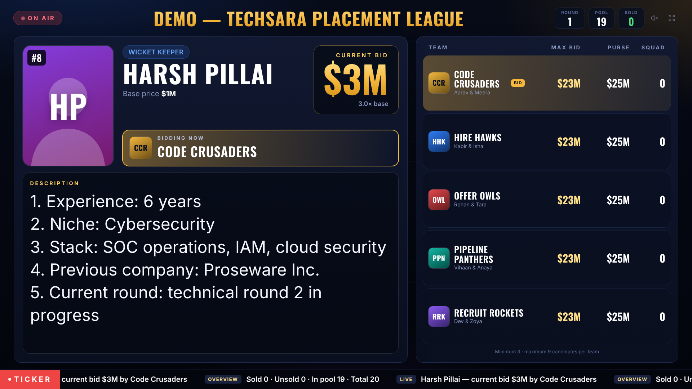
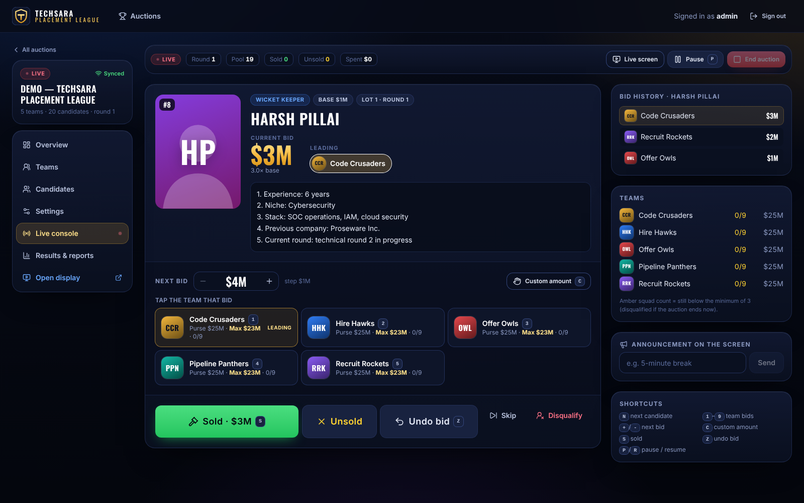
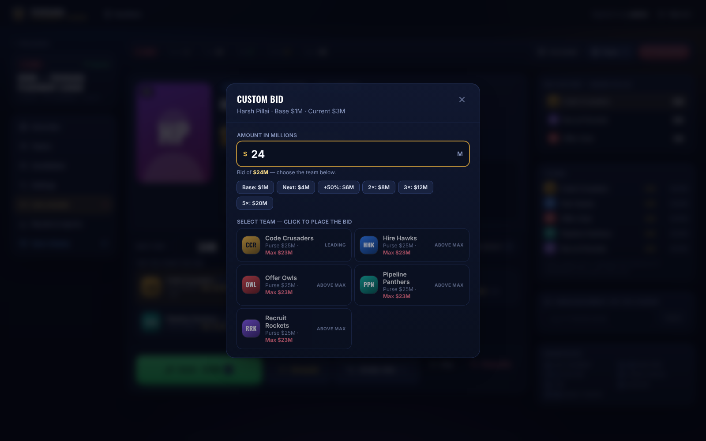
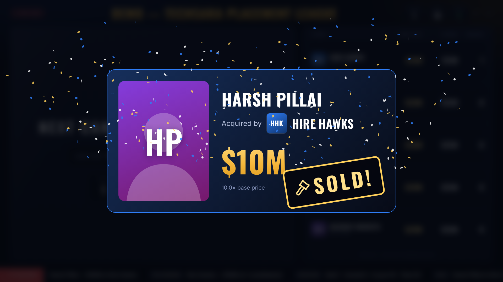
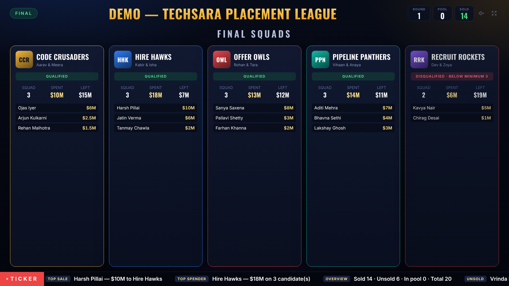

# TechSara Placement League

A live candidate-auction game for TechSara events. Teams spend a fixed virtual purse on job candidates; the organizer runs the room from one console and the audience follows on a big live screen that updates in milliseconds.

Built from the client's Hindi requirement video with the rules the client stated: **5 teams · $25M purse · base $1M · minimum 3 / maximum 9 candidates · max bid = purse − base × (minimum − 1) → $23M · teams below the minimum are disqualified at the end**, full point-wise candidate descriptions on screen, and custom bids typed in millions that can never exceed a team's max bid.

**Production:** https://tpl.techsarasolutions.com (organizer console: `/admin`) — deployed automatically from `main` (see [Production deployment](#production-deployment)).



| Live console | Custom bid capped at the max bid | Sold | Final squads |
|---|---|---|---|
|  |  |  |  |

All screenshots (organizer pages, phone, 1080p projector, 4K LED wall) are in `docs/screenshots/`; they were taken with fictional sample data.

## Quick start (Windows, macOS or Linux)
Requirements: **Node.js 20.11+** (22 LTS recommended). Nothing else — PostgreSQL is bundled.

```bash
npm install
npm run setup        # creates .env with a random organizer password and the database
npm run build
npm start            # → http://localhost:3000   (use `npm run dev` while developing)
```
`npm run setup` prints the organizer login once (it is also in `.env` as `ADMIN_PASSWORD`).

**Or with Docker** (Docker Desktop): double-click **`start-with-docker.cmd`** on Windows (or run `docker compose up -d --build`) → **http://localhost:3000/admin**; `stop-docker.cmd` stops it. The organizer password is `ADMIN_PASSWORD` in `.env`, or — when that is not set — printed once by `docker compose logs app`. Details: `docs/DEPLOYMENT_GUIDE.md` (Option C).

Then:
1. Sign in at **http://localhost:3000/admin** and create an auction (teams, candidates, settings).
2. **Overview → Lock configuration → Open live console**.
3. Open the **Live screen** link on the projector (other devices use the network address printed in the server console, e.g. `http://192.168.1.20:3000/display/<code>`; allow Node.js through the Windows firewall on private networks).
4. **Go live → Next candidate → tap the team that bid** (or *Custom amount*: type `10` for $10M) **→ Sold**.

## Production deployment
`main` is deployed by GitHub Actions (`.github/workflows/deploy.yml`) to an AWS EC2 server, behind a Cloudflare Tunnel:

```
push to main → tests (typecheck, lint, unit, integration, build, end-to-end)
             → copy the release to the server over SSH → deploy/deploy.sh
             → docker compose -f docker-compose.prod.yml up -d --build   (PostgreSQL + app + cloudflared)
browser → https://tpl.techsarasolutions.com → Cloudflare → tunnel → http://app:3000
```
- **Repository secrets:** `EC2_HOST`, `EC2_SSH_KEY`, `CLOUDFLARE_TUNNEL_TOKEN` (optional `TPL_ADMIN_PASSWORD`, `EC2_USER`). Without them the deploy job is skipped with a warning.
- **Cloudflare:** the tunnel's public hostname `tpl.techsarasolutions.com` → service `http://app:3000`.
- **Server:** Ubuntu or Amazon Linux; Docker is installed on the first deploy. No inbound port is needed for the app (SSH only, for deployments). Secrets live in `/opt/techsara-placement-league/shared/.env` on the server — never in this repository.

Step-by-step: `docs/DEPLOYMENT_GUIDE.md` → Option D.

## What's inside
| Area | Where |
|---|---|
| Organizer console (setup, live console, results) | `src/app/admin/**` |
| Live screen | `src/app/display/[slug]`, `src/components/display/stage.tsx` |
| Rules (max bid, validation, ordering) | `src/shared/rules.ts` (shared by server and browser) |
| Server-authoritative engine | `server/engine/engine.ts` |
| REST API · WebSocket | `server/api/router.ts` · `server/realtime/socket.ts` |
| Database schema · migrations | `server/db/schema.ts` · `drizzle/` |
| Tests | `tests/unit`, `tests/integration`, `tests/e2e` |
| Deployment | `Dockerfile`, `docker-compose.yml` (local), `docker-compose.prod.yml` (server), `deploy/deploy.sh`, `.github/workflows/deploy.yml` |
| Video analysis tooling | `tools/video-analysis/` |

## Scripts
| Command | Does |
|---|---|
| `npm run dev` | Development server (UI + API + WebSocket) on port 3000 |
| `npm run build` / `npm start` | Production build / production server |
| `npm run setup` | First-time setup (`.env`, database, organizer account) |
| `npm run create-admin -- <user> <password>` | Add an organizer or reset a password |
| `npm run db:start` | Run only the embedded PostgreSQL (for DB tools) |
| `npm test` | Unit + integration tests (real PostgreSQL) |
| `npm run test:e2e` | Playwright end-to-end tests (run `npm run build` first; first time: `npx playwright install chromium`) |
| `npm run typecheck` · `npm run lint` | Static checks |

## Documentation
- Product & rules: `docs/requirements/` (requirements with video timestamps, game rules, roles, traceability)
- Architecture: `docs/architecture/` · Design: `docs/design/` · Research: `docs/research/`
- Guides: `docs/SETUP_GUIDE.md`, `docs/ADMIN_GUIDE.md`, `docs/GAMEPLAY_GUIDE.md`, `docs/DEPLOYMENT_GUIDE.md`
- Quality: `docs/TEST_REPORT.md`, `docs/REQUIREMENTS_COVERAGE.md`, `docs/KNOWN_LIMITATIONS.md`, `docs/FINAL_DELIVERY_REPORT.md`
- Build brief generated from the analysis: `TECHSARA_PLACEMENT_LEAGUE_BUILD_MASTER_PROMPT.md`
- The internal analysis of the requirement video (`docs/video-analysis/`: transcript, translation, frames) is kept out of the public GitHub repository.
