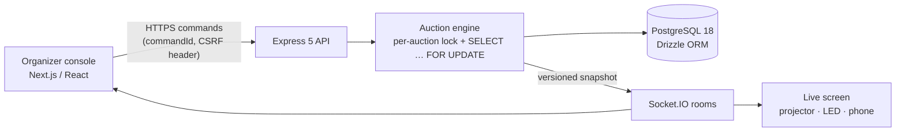

# Final Delivery Report — TechSara Placement League

Date: 31 October 2026 · Built autonomously from the client's requirement video and the reference sites.

## 1. Outcome
A working full-stack live-auction application for TechSara's placement event:
- An **organizer console**: setup, a live console and results.
- A **public live screen** that follows every action in milliseconds.

The video was fully transcribed, translated and analysed screen by screen. Every requirement confirmed in it (35 of 35) is implemented, and 33 of them are covered by automated tests. All checks pass on the final code:
- type check, lint, format and a clean production build
- 25 unit, 21 integration and 5 end-to-end browser tests

**Five business questions are still open for the client.** They are not built, and nothing was invented for them (§4).

## 2. Video analysis (`docs/video-analysis/`)
| Item | Result |
|---|---|
| **Video** | `game building auction.mp4`: 541.17 s (**9 min 01 s**), 1920 × 1076, 30 fps, 599 MB. Read only, never modified; the analysed copy is SHA-256 identical. |
| **Timeline coverage** | **100 %**: 32 speech chunks and 24 non-speech gaps, with no holes (`TRANSCRIPT_TIMELINE.md`). |
| **Transcription coverage** | VAD found 381.45 s of speech in 125 regions; 468.06 s were sent to recognition. **32 / 32 chunks** were decoded by Whisper large-v3 (primary) and **32 / 32** by Whisper large-v3-turbo (independent second hearing). There are no failed chunks. Non-speech gaps were measured, and the 4 audible ones were decoded too; no missed sentence was found. |
| **Translation** | **32 / 32 chunks** in English, with notes on every doubtful word (`FULL_ENGLISH_TRANSLATION.md`). |
| **Uncertain passages** | 5 chunks (≈ 85 s) are marked ⚠. Only **06:18–06:36** is largely unintelligible: it contains “…bold … bold”, which becomes open question Q-06. |
| **Visual coverage** | 181 timestamped thumbnails (one every 3 s, covering the whole video), with full-resolution frames read wherever small text mattered. Scene detection found 208 changes, mapped to 44 screen ranges. 23 evidence frames are kept. |
| **Speakers** | One voice dominates (85.5 % of speech). Minor voice clusters are labelled as hints only, and no requirement depends on who said it. |

Deliverables in `docs/video-analysis/`:
- `FULL_HINDI_TRANSCRIPT.md`
- `FULL_ENGLISH_TRANSLATION.md`
- `TRANSCRIPT_TIMELINE.md`
- `FRAME_BY_FRAME_ANALYSIS.md`
- `SCREEN_INTERACTION_MAP.md`
- `VIDEO_COVERAGE_REPORT.md`

## 3. Reference research (`docs/research/`)
The public pages of cricsmart.in and auction.cricsmart.in were read, including the client's public TPL auction pages.
- **Login-protected organizer area (`/admin`):** not accessed. It is recorded as unverified and is known only from the client's own recording.
- **Live / broadcast pages:** render over WebSocket, so only their shell could be fetched.

Nothing was copied (code, branding, logos or text). `FEATURE_COMPARISON.md` maps every reference feature to what was built.

## 4. Requirements (`docs/requirements/`, `docs/REQUIREMENTS_COVERAGE.md`)
| Class | Count | Status |
|---|---|---|
| **CONFIRMED** (stated or shown in the video, with timestamp) | 35 IDs | **35 implemented**. 33 are verified by automated tests. Two were checked visually: the card view, and the photo-upload dialog (its API is integration-tested). |
| **INFERRED** (from the demonstrated reference flow) | 12 IDs | All implemented (some verified visually) |
| **PROPOSED** (engineering and UX) | — | Implemented: server authority, idempotency, crash recovery, security, responsive layouts and the others listed in `COMPLETE_PRODUCT_REQUIREMENTS.md` |
| **UNRESOLVED** | 8 questions | **5 blocked awaiting the client** (below). 3 are handled by configurable behaviour (Q-03 team names/trademarks, Q-05 re-auction rounds, Q-08 candidate privacy). |

**Incomplete:** none of the confirmed or inferred requirements.

**Blocked, awaiting a client decision** (details in `docs/KNOWN_LIMITATIONS.md`):
- **Q-01:** how the league winner is decided.
- **Q-02:** whether team members bid from their phones.
- **Q-04:** whether the timer auto-sells at time-up. Today it only shows "time up".
- **Q-06:** bold text in descriptions (unclear audio).
- **Q-07:** what disqualification means after the event.

**Key client rules as built:**
- 5 teams, $25M purse each, $1M base price.
- 3 to 9 candidates per team.
- Max bid = remaining purse − base × (minimum − bought − 1). This gives $23M for an empty team and $22M after a $2M buy.
- A custom bid is typed in millions and can never exceed the team's max bid (24 is rejected, 23 is accepted).
- The leading team moves to the top of the board.
- The full point-wise description is shown on screen, with bullets and line breaks kept exactly.
- Round / Pool / Sold counters.
- Teams below the minimum are disqualified when the auction ends.

## 5. Architecture summary (`docs/architecture/`)

- **One process** serves the UI (Next.js 16), the REST API (Express 5) and WebSockets (Socket.IO 4.8) on one port.
- **Database:** PostgreSQL through Drizzle. An embedded PostgreSQL 18 is bundled, so nothing needs installing; set `DATABASE_URL` to use an external server.
- **The server is the only authority.** Every action is an idempotent command.
  - Commands are serialised per auction and locked at row level.
  - Each command is stored with an audit entry.
  - Each command is broadcast as a new versioned snapshot; screens only render it.
- **Money:** stored as whole thousands (1000 = $1M), so there are no floating-point errors.
- **Countdown:** the timer deadline is kept on the server.
- **Recovery:** after a crash the live state is restored from the database.
- **Security:**
  - bcrypt passwords; hashed session tokens in HttpOnly SameSite cookies
  - CSRF header plus Origin check; rate-limited login
  - Helmet security headers; magic-byte image validation; audit log

## 6. Status by layer
| Layer | Status |
|---|---|
| **Frontend** | ✅ 11 routes: landing, login, auctions, overview, teams, candidates, settings, live console, results & reports, live screen, not-found. Premium dark broadcast design, readable on projector, 4K LED wall and phone. Keyboard shortcuts in the console; reduced-motion support. |
| **Backend** | ✅ REST API for auth, auctions (create/duplicate/lock/unlock/reset), teams, candidates (Excel/CSV import, photo upload), live commands (15 types), corrections and reports (results, bid history, audit log, Excel export). |
| **Database** | ✅ 9 tables and 1 migration. Constraints guarantee one open lot per auction and consistent sold records. Tests use separate databases; no demo data ships with the app. |
| **Real-time** | ✅ One Socket.IO room per auction. A command reaches the display in **under 25 ms** on localhost (8.6–23.9 ms measured across runs). Reconnecting screens restore the exact state, and a server restart keeps the live auction. |

## 7. Test results (`docs/TEST_REPORT.md`)
| Check | Result |
|---|---|
| `npx tsc --noEmit` | ✅ 0 errors |
| `npx eslint .` | ✅ 0 errors, 0 warnings |
| `npx prettier --check .` | ✅ |
| `rm -rf .next && npx next build` | ✅ 11 routes |
| `npx vitest run`: unit | ✅ **25 / 25** |
| `npx vitest run`: integration (real PostgreSQL, HTTP, WebSocket) | ✅ **21 / 21** |
| `npx playwright test`: end-to-end, production build, Chromium | ✅ **5 / 5** |
| Docker image steps reproduced outside Docker (production-only install, image start command, fresh external PostgreSQL) | ✅ |
| Docker Compose on the client laptop (Windows, Docker Desktop) | ✅ image built, both containers running, app served at http://localhost:3000 |
| Demo run on the production server | ✅ Full demo auction played to the end; 15 screenshots taken (plus 2 from the end-to-end layout test); 0 page or console errors; Excel export checked |

**Not tested:**
- Native Windows with Node.js (`npm start`). The Docker setup did run on the client's Windows laptop.
- Real projector / LED hardware.
- Safari and Firefox.
- Long load tests.

## 8. Run it
**Local development URL: http://localhost:3000**
- Organizer console: `/admin`
- Live screen: `/display/<code>`, linked from the console

```bash
npm install
npm run setup     # .env with a random organizer password (printed once) and the database
npm run build
npm start         # http://localhost:3000   (npm run dev for development)
```
Requires Node.js 22 LTS (or ≥ 20.11). Nothing else: PostgreSQL is bundled.

**With Docker instead** (Docker Desktop; no Node.js needed): `docker compose up -d --build` → http://localhost:3000/admin. The organizer password is `ADMIN_PASSWORD` in `.env`, or — when that is not set — shown once by `docker compose logs app`. The port can be changed with `APP_PORT` in `.env` (`docs/DEPLOYMENT_GUIDE.md`, Option C). Other devices on the same Wi-Fi use the network address printed at start-up. Full details are in `docs/SETUP_GUIDE.md`.

## 9. Operate the game (`docs/ADMIN_GUIDE.md`, `docs/GAMEPLAY_GUIDE.md`)
1. Sign in at `/admin`.
2. Create an auction (or duplicate an existing one).
3. Set up the auction:
   - **Settings:** purse, base price, minimum/maximum squad.
   - **Teams:** name, colour, logo, members.
   - **Candidates:** photo, role, point-wise description. You can import them from the Excel template.
4. On **Overview**, press **Lock configuration**, then **Open live console**.
5. Open **Live screen** on the projector.
6. Press **Go live → Next candidate**. When a team calls a bid, **tap that team**. For a custom amount, press **C** and type `10` for $10M; teams whose max bid is too low are disabled.
7. Use **Sold / Unsold / Undo / Pause** as needed.
8. When the pool is empty, start the next round for unsold candidates, or press **End auction**. Teams below the minimum are disqualified.
9. In **Results & reports**, use **Export Excel** for squads, bid history and the audit log.

## 9b. Production (added after delivery)
- **Repository:** `namanjain221995/Techsara-Placement-League` (public — the internal video analysis is not published there).
- **Pipeline:** `.github/workflows/deploy.yml` — every push and pull request runs typecheck, lint, format check, unit + integration tests, the production build and the end-to-end tests; pushes to `main` are then deployed to the EC2 server over SSH by `deploy/deploy.sh` (Docker Compose: PostgreSQL + app + Cloudflare Tunnel).
- **Address:** `https://tpl.techsarasolutions.com` through the Cloudflare Tunnel (public hostname → `http://app:3000`).
- **Demo data removed:** the fictional demo auction and its seed scripts are no longer part of the app.
- Setup steps (GitHub secrets, Cloudflare public hostname, security group): `docs/DEPLOYMENT_GUIDE.md` → Option D.

## 10. Deployment readiness
| Scenario | Assessment |
|---|---|
| **One event on a laptop + projector + venue Wi-Fi** | **Ready.** Do one rehearsal on the event laptop first (Windows firewall prompt, projector resolution), then run **Reset** on the auction. |
| **Hosting on the internet** | **Ready with standard hardening:** an HTTPS reverse proxy with `COOKIE_SECURE=true`, a managed PostgreSQL (`DATABASE_URL`), a strong organizer password, and backups. The steps are in `docs/DEPLOYMENT_GUIDE.md`. Nothing was deployed and no paid service was used. |
| **Several large events at once / horizontal scaling** | Not ready as-is: it runs as a single server process, and scaling out needs a Socket.IO adapter (e.g. Redis). |

## 11. Constraints honoured
- **No Git commands, no public deployment, no paid services, no destructive operations.** The original video was not modified.
- **No access controls were bypassed.** The reference organizer area is recorded as unverified.
- **No proprietary code, branding or images were used.** The logo is original; candidate portraits are generated initials; there is no player photography or franchise branding. Teams and candidates in tests and screenshots are invented (`docs/design/ASSET_LICENSES.md`).
- **No production credentials are embedded.**
  - There is no built-in default password: `npm run setup` generates a random one, and a server started without one generates and prints its own.
  - `.env` is not part of the package.
- **Transcript, observations and requirements are not fabricated.** Unclear audio is labelled unclear, and open business rules are listed as questions.

## 12. Where everything is
| What | Where |
|---|---|
| Overview and quick start | `README.md` |
| Build specification (22 sections) | `TECHSARA_PLACEMENT_LEAGUE_BUILD_MASTER_PROMPT.md` |
| Video analysis | `docs/video-analysis/` |
| Reference research | `docs/research/` |
| Requirements | `docs/requirements/` |
| Architecture | `docs/architecture/` |
| Design | `docs/design/` |
| Screenshots (fictional sample data) | `docs/screenshots/` |
| Guides | `docs/SETUP_GUIDE.md`, `ADMIN_GUIDE.md`, `GAMEPLAY_GUIDE.md`, `DEPLOYMENT_GUIDE.md` |
| Quality | `docs/TEST_REPORT.md`, `REQUIREMENTS_COVERAGE.md`, `KNOWN_LIMITATIONS.md` |
| Progress checkpoint | `docs/planning/IMPLEMENTATION_PROGRESS.md` |
| Analysis tools | `tools/video-analysis/` |
