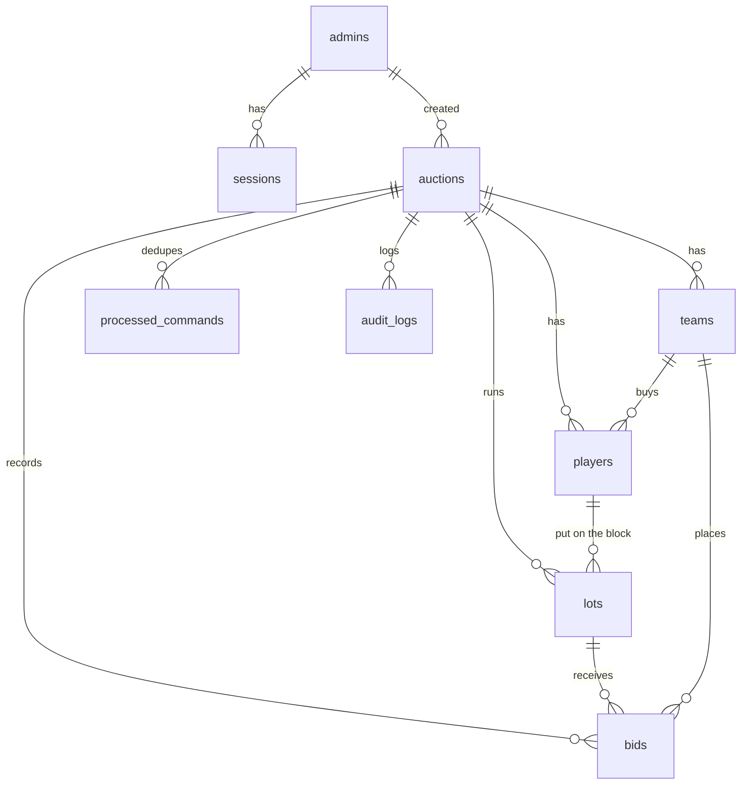

# Database Design (PostgreSQL)

Source: `server/db/schema.ts`; migration: `drizzle/0000_init.sql` (generated by drizzle-kit, applied automatically at start-up by `server/db/migrate.ts`).

**Money** columns are `integer` in thousands of the auction currency (1000 = $1M). Integer arithmetic avoids floating-point drift; the UI always shows/takes millions.

## Tables
| Table | Purpose | Key columns & constraints |
|---|---|---|
| `admins` | Organizer accounts | `username` UNIQUE, bcrypt `password_hash` |
| `sessions` | Login sessions | PK `token_hash` (SHA-256 of the cookie token), `expires_at`; cascade on admin delete |
| `auctions` | One event | `slug` UNIQUE (display code), `status` enum DRAFT/LOCKED/LIVE/PAUSED/COMPLETED, `purse`, `base_price`, `bid_increment`, `min_squad`, `max_squad`, `timer_enabled`, `timer_seconds`, `pool_order` enum, `roles` jsonb, `round`, `lot_sequence`, `current_lot_id`, `last_lot_id`, `announcement`, **`version`** (monotonic; every change +1). CHECKs: squad 0 ≤ min ≤ max, max ≥ 1; money > 0; timer 5–600 s; round ≥ 1 |
| `teams` | Bidding teams | `members` jsonb, `purse`, `sort_order`, `disqualified` (set at END). UNIQUE (auction, lower(name)); CHECK purse > 0 |
| `players` | Candidates | `number` UNIQUE per auction, `role`, `description` (exact text), `photo_path`/`photo_url`, `base_price` (nullable → auction base), `status` enum POOL/SOLD/UNSOLD/DISQUALIFIED, `sold_price`, `sold_to_team_id` (RESTRICT), `sold_round`. CHECK **status = SOLD ⇔ sold team and price present**; money > 0 |
| `lots` | One candidate's time on the block | `sequence` UNIQUE per auction, `round`, `result` enum OPEN/SOLD/UNSOLD/SKIPPED/DISQUALIFIED, `base_price`, `current_bid`, `leading_team_id`, `final_amount`, `winning_team_id`, `timer_ends_at`, `timer_remaining_ms` (paused), `time_up`. **Partial UNIQUE (auction_id) WHERE result = 'OPEN'** → never two candidates on the block |
| `bids` | Every bid | bigserial id (ordering), `lot_id`, `team_id`, `amount` (CHECK > 0), `placed_by`, `command_id` UNIQUE, `undone_at` (soft undo keeps history) |
| `processed_commands` | Idempotency | PK `command_id` (client UUID), `result_version` |
| `audit_logs` | Who did what | `actor_label`, `action` (e.g. `live.sold`, `team.update`), `details` jsonb, `ip` |

## Derived values (never stored)
- `spent(team)` = Σ `sold_price` of its SOLD candidates; `squad(team)` = count.
- `remaining` = `purse − spent`; `max bid` per `src/shared/rules.ts#maxBid`.

## Transactions
Every mutation runs in one transaction that row-locks the auction (`SELECT … FOR UPDATE`), applies the change, increments `version`, writes `processed_commands` and `audit_logs`, then commits. Readers (snapshots) never see a half-applied command.

## Indexes
`teams(auction_id)`, `players(auction_id, status)`, `lots(player_id)`, `bids(lot_id, id)`, `audit_logs(auction_id, created_at)`, `processed_commands(auction_id)`, `sessions(admin_id)`.

## Data lifecycle
- Delete auction → cascades to teams, candidates, lots, bids, commands, audit (an `auction.delete` audit row without auction id remains).
- Reset (rehearsal) → deletes lots, bids, processed commands; candidates back to POOL; teams un-disqualified; status LOCKED.
- Uploaded images live in `UPLOAD_DIR` with random UUID names; cloning copies files.
- Backups: `pg_dump` the database and copy `storage/uploads` (see Deployment Guide).
