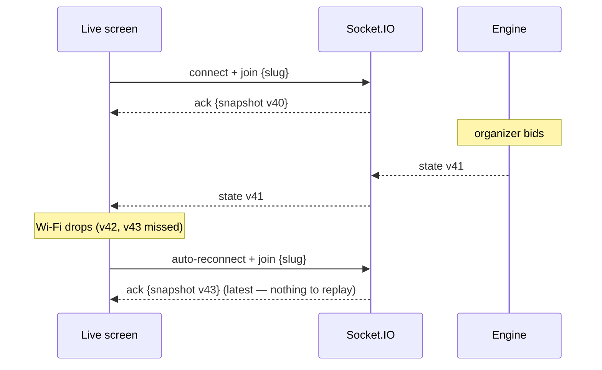

# Real-time Event Protocol

Transport: Socket.IO 4 at path `/socket.io` (WebSocket first, HTTP long-polling fallback). Rooms per auction: **`auction:<auctionId>:org`** (signed-in organizers — full snapshot) and **`auction:<auctionId>:pub`** (public screens — `publicSnapshot(…)`, which strips every organizer-only field). One broadcast emits both.

## Principles
1. **Server-authoritative.** Browsers never compute game state; they render the snapshot they receive. Shared rule functions are used in the UI only to *pre-validate* (disable buttons, show max bids).
2. **Full, versioned snapshots.** Every accepted change (command, setup edit, countdown time-up) increments `auctions.version` inside the same transaction and broadcasts the complete `LiveSnapshot`. Clients keep the highest version and drop anything older.
3. **Commands don't travel over the socket.** They go through `POST /api/auctions/:id/commands` (auth, CSRF, validation, idempotency). The HTTP response also returns the new snapshot, so the acting console updates even before the broadcast arrives.

## Messages
| Direction | Event | Payload | Ack |
|---|---|---|---|
| client → server | `join` | `{slug}` (public screen) or `{auctionId}` (organizer; session cookie checked in the handshake) | `{ok:true, snapshot}` or `{ok:false, error:"NOT_FOUND"\|"UNAUTHORIZED"\|"BAD_REQUEST"}` |
| client → server | `sync` | `{}` | `{ok:true, snapshot}` — safety net every 15 s. For an organizer socket the session is re-checked; an ended session leaves the organizer room (`{ok:false, error:"UNAUTHORIZED"}`) |
| client → server | `clock` | `{}` | `{now}` (server epoch ms) — clock offset, every 30 s |
| server → room | `state` | `LiveSnapshot` | — |

## `LiveSnapshot` (abridged — see `src/shared/types.ts`)
```ts
{
  version: 57, serverNow: 1793420000000,
  auction: { id, slug, name, status, currencySymbol, purse, basePrice, bidIncrement, minSquad, maxSquad,
             timerEnabled, timerSeconds, poolOrder, roles, round, ... },
  teams: [{ id, name, shortName, color, logoUrl, members, sortOrder, purse, spent, remaining, squadCount, maxBid, disqualified }],
  lot: { id, sequence, round, player: {...}, basePrice, currentBid, leadingTeamId, bids: [...newest first],
         timer: { enabled, durationMs, endsAt, remainingMs, timeUp } } | null,
  lastResult: { result: "SOLD"|"UNSOLD"|..., player, teamId, amount, at } | null,
  stats: { total, pool, sold, unsold, disqualified, totalSpent, topSale, topSpender },
  announcement: { text, at } | null,
  reveal: { status: "NOT_STARTED"|"IN_PROGRESS"|"COMPLETE", index, step, count,
            current: RevealCard | null,      // fields stay null until their step: originalName ≥1, letter ≥2, annualSalary ≥3, teamId ≥4
            revealed: RevealCard[],          // fully revealed profiles
            standings: TeamStanding[] },     // visible totals so far; ranks/winner only when COMPLETE
  private?: {                                // ORGANIZER ROOM ONLY — never in a public payload
    standings: TeamStanding[],               // hidden live salary totals (SOLD only), ranked
    profiles: PrivatePlayerView[],           // original names, salaries, letters
    revealCheck: { blocking: string[], warnings: string[] } },
  event: { type: "BID_PLACED", at, teamId, amount, playerId }   // what caused this snapshot
}
```
`event.type` ∈ `SNAPSHOT, WENT_LIVE, PAUSED, RESUMED, PLAYER_UP, BID_PLACED, BID_UNDONE, SOLD, UNSOLD, SKIPPED, PLAYER_DISQUALIFIED, NEXT_ROUND, TIME_UP, ANNOUNCEMENT, AUCTION_COMPLETED, SETUP_CHANGED, REVEAL_STARTED, REVEAL_STEP, REVEAL_COMPLETE, REVEAL_RESET`. Screens use it only for effects (SOLD overlay, sounds); the rest of the snapshot is the truth.

## Sequence: connect, bid, drop, recover


## Guarantees
| Concern | Mechanism |
|---|---|
| Ordering | Per-auction in-process queue (`runExclusive`) + `SELECT … FOR UPDATE`; versions strictly increase |
| Duplicate requests | `processed_commands` PK on the client `commandId`; duplicate returns `duplicate:true` without effect |
| Conflicting actions (two operators) | Applied one after another; the second is validated against the first's result (e.g. `NOT_ABOVE_CURRENT_BID`, `NO_PLAYER_ON_BLOCK`) |
| Missed messages | Re-join on reconnect, `sync` every 15 s, version check |
| Countdown accuracy | Deadline `timer_ends_at` stored in DB; screens render `endsAt − (Date.now() + clockOffset)`; server sets `time_up` via a timer re-armed after restarts |
| Restart | All state in PostgreSQL; `engine.recover()` re-arms countdowns; screens reconnect automatically |
| Latency | Measured command → screen in the integration test (logged in `docs/TEST_REPORT.md`) |
