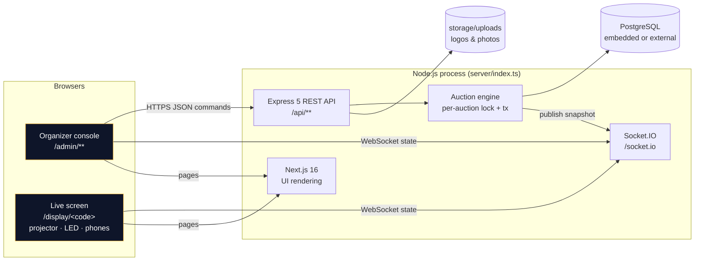
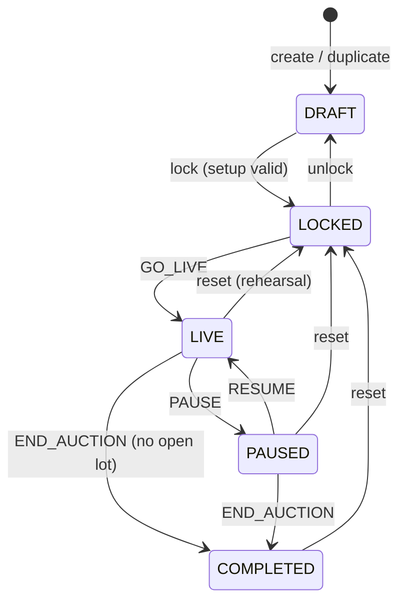

# System Architecture

## 1. Overview
One Node.js process serves everything on one port (default 3000): the organizer UI and live screen (Next.js), the REST API (Express 5), real-time push (Socket.IO) and the server-authoritative auction engine. State lives in PostgreSQL — an embedded PostgreSQL for zero-install local runs, or any external PostgreSQL via `DATABASE_URL`.



## 2. Technology choices
| Concern | Choice | Why |
|---|---|---|
| UI | Next.js 16 (App Router) + React 19 + TypeScript 5.9 + Tailwind CSS 4 | Brief's preferred stack; fast, typed, responsive |
| Motion | `motion` (layout animations for team reordering), GSAP (SOLD stamp), canvas-confetti | Smooth reorders when the leader changes; one complex timeline |
| UI primitives | Radix Dialog + small in-house components in shadcn style | The shadcn CLI registry is not reachable offline; components are written in the same pattern |
| Fonts | Inter Variable + Oswald Variable via `@fontsource` (bundled, offline) | Projector-readable display face; no Google Fonts call at runtime |
| API | Express 5 (async errors handled natively) | Mature, simple, shares the process with Socket.IO and Next |
| Real-time | Socket.IO 4 (WebSocket with polling fallback, automatic reconnection) | Robust reconnection on venue Wi-Fi |
| Database | PostgreSQL 18 (embedded via `embedded-postgres`) / any PostgreSQL ≥ 14 | Transactions, row locks, constraints |
| Data layer | Drizzle ORM + `pg` + SQL migrations in `/drizzle` | "Prisma or equivalent": no native engine download (Prisma's binary host is unreachable in the build sandbox) |
| Validation | Zod 4 schemas shared by browser and server | One definition, server-authoritative |
| Auth | bcrypt password hash + random session token (SHA-256 stored) in HTTP-only cookie | Revocable sessions, no JWT secret management |
| Tests | Vitest (unit + integration on real PostgreSQL), Playwright (E2E on the production build) | |

## 3. Code layout
```
server/
  index.ts            entry: build + listen + graceful shutdown
  app.ts              buildServer(): DB → migrations → admin → engine → Express → Socket.IO → Next
  config.ts           env (.env loader)
  db/                 schema.ts (Drizzle), bootstrap.ts, embedded.ts, migrate.ts
  auth/auth.ts        sessions, password hashing, requireAdmin, csrfGuard
  engine/engine.ts    AuctionEngine: live commands, corrections, setup mutations, countdown, recovery
  engine/snapshot.ts  LiveSnapshot builder (single read model for every screen)
  realtime/socket.ts  Socket.IO rooms, join/sync/clock
  api/router.ts       REST endpoints
  services/           catalog (auctions/teams/candidates), spreadsheets (import/export/results), uploads, audit
src/
  shared/             money.ts, rules.ts, schemas.ts, types.ts — imported by server AND browser
  app/                pages: /, /login, /admin/**, /display/[slug]
  components/         ui/*, admin/*, display/stage.tsx, media, description
  lib/                api client, live hook (socket + clock offset + countdown)
drizzle/              SQL migrations
scripts/              setup, migrate, db-start, create-admin
deploy/               deploy.sh (server-side deploy used by .github/workflows/deploy.yml)
tests/                unit/, integration/, e2e/
tools/video-analysis/ reproducible transcription & frame-extraction pipeline
```

## 4. Command flow (one bid)
```mermaid
sequenceDiagram
  participant O as Organizer console
  participant API as Express /commands
  participant EN as AuctionEngine
  participant DB as PostgreSQL
  participant IO as Socket.IO room
  participant S as Live screens
  O->>API: POST {type:"BID", teamId, amount, commandId}
  API->>EN: execute(auctionId, cmd)
  EN->>EN: runExclusive(auctionId) — queue behind other commands
  EN->>DB: BEGIN; SELECT processed_commands (duplicate?)
  EN->>DB: SELECT auction FOR UPDATE; load lot, team finances
  EN->>EN: checkBid() — status, base, > current, ≤ max bid, squad
  EN->>DB: INSERT bid; UPDATE lot; version+1; INSERT processed_command; INSERT audit; COMMIT
  EN->>DB: build snapshot
  EN-->>IO: emit "state" (snapshot v+1)
  IO-->>S: state
  EN-->>API: {snapshot, duplicate:false}
  API-->>O: 200 (console updates immediately)
```

## 5. State machine

Lot (candidate on the block): `OPEN → SOLD | UNSOLD | SKIPPED | DISQUALIFIED`. At most one open lot per auction (partial unique index).

## 6. Key decisions
1. **Full snapshots, not deltas.** Every change broadcasts the complete live state (~5–15 KB). Screens never accumulate drift; a reconnecting screen needs only the latest snapshot. Versions are monotonic per auction, so out-of-order messages are ignored.
2. **Commands over HTTP, state over WebSocket.** Commands get normal HTTP auth, CSRF checks, validation errors and idempotency keys; the socket only distributes state.
3. **Derived money.** Spent and squad size are computed from SOLD candidates, never stored, so a correction (return to pool) automatically refunds the purse.
4. **One process.** A single event needs no horizontal scaling; per-auction serialisation in-process plus `SELECT … FOR UPDATE` keeps it correct even if a second process is started by mistake.
5. **Organizer-entered bids.** Matches the demonstrated flow (bids are called out in the room). Remote team bidding is an open question (Q-02).
6. **Countdown never auto-sells** until the client decides (Q-04).

## 7. Deployment views
- **Event laptop (recommended):** `npm run build && npm start` on the organizer's laptop; projector PC/phones open `http://<laptop-ip>:3000/display/<code>` on the same network.
- **Server/cloud:** same process behind a TLS reverse proxy with `DATABASE_URL` to a managed PostgreSQL and `COOKIE_SECURE=true` (see `docs/DEPLOYMENT_GUIDE.md`).
